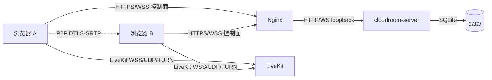

# CloudRoom 架构

## 总览

CloudRoom 是“控制面 + 媒体面”分离的实时房间系统：

- **控制面（CloudRoom 自己）**：身份、会话、房间生命周期、建房申请与审批、文字频道、成员/禁言/邀请、审计、在线心跳，以及短期媒体凭证签发。运行在单个静态 Rust 二进制 + SQLite 中，只监听 loopback/Unix socket，公网 TLS 由 Nginx 终止。
- **媒体面（LiveKit）**：WebRTC 信令、ICE、UDP 媒体转发与内嵌 TURN。浏览器直接连接 LiveKit；CloudRoom 只为已授权成员签发短期 JWT（SFU）或短期 LiveKit 格式 TURN 凭证（P2P）。

独立 coturn 不参与任何路径；P2P 的 relay 由 LiveKit 内嵌 TURN 提供。



## 房间媒体模式

每个标准房间都有显式的 `media_mode`，创建房间时必须选择，之后只能通过申请/审批变更：

| 模式 | 媒体路径 | 适用 |
|---|---|---|
| `p2p` | 浏览器之间 DTLS-SRTP 直连；CloudRoom WSS 仅中继 SDP/ICE；无法直连时使用 LiveKit 内嵌 TURN relay | 小房间（默认上限 `p2p_voice_max_participants=4`） |
| `sfu` | 浏览器 ↔ LiveKit：CloudRoom 签发短期 JWT（`canPublishSources` 为 microphone + screen_share），`livekit-client` 只发布/订阅音频 | 多人房间、更稳定的媒体体验 |

- 私聊（direct）房间在创建时继承父标准房间的媒体模式，不能单独申请变更。
- 媒体端点与模式绑定：`GET /api/v1/rooms/{code}/ice-servers` 只接受 p2p 房间，`POST /api/v1/rooms/{code}/media-token` 只接受 sfu 房间，错配返回 `409 media_mode_mismatch`。
- WSS 上的 `voice_join`/`voice_leave`/`voice_state`/`signal` 事件只属于 p2p 房间；sfu 房间收到这些事件返回 `media_mode_mismatch`。

## 建房与模式变更审批

创建房间和变更媒体模式使用同一条申请链路，全部写在 `room_requests` 表并走 `POST /api/v1/room-requests`：

```
请求方: kind=create_room | change_media_mode + media_mode (+ room_code)
   │
   ▼
room_requests (pending) ──► 管理员 POST /admin/room-requests/{id}/approve|reject
   │                              （申请人不能批准自己的模式变更申请）
   ▼
approved: create_room → 新建房间（写入申请时的 media_mode）
          change_media_mode → 原子更新 rooms.media_mode + 审计
```

- 超级管理员提交即自动批准（与建房规则一致）。
- 同一房间同时只允许一个 pending 的模式变更申请（数据库唯一部分索引兜底）。
- 审批时重新校验：房间仍 active、申请人仍是房主、目标模式与当前不同；任一失效即整体拒绝，不部分应用。
- `rooms` 的 settings 接口不再接受 `media_mode`（旧字段返回 422），杜绝绕过审批通道。

## 媒体凭证

| 端点 | 校验 | 返回 |
|---|---|---|
| `GET /api/v1/rooms/{code}/ice-servers` | 成员 + `join_voice` + 房间为 p2p | LiveKit 内嵌 TURN 的短期 `iceServers`（UDP 3478，TTL 300s） |
| `POST /api/v1/rooms/{code}/media-token` | CSRF + 成员 + `join_voice` + 房间为 sfu | `{ token, url, room }`：HS256 JWT，`media_token_ttl` 有效，grant 为 `room/roomJoin/participant/canPublish/canSubscribe`，`canPublishSources=["microphone","screen_share"]` |

LiveKit API key/secret 只存在于 `/etc/livekit.yaml` 与 `/etc/cloudroom/config.toml`；浏览器永远只拿到短期凭证。

## 控制面 WebSocket

`/api/v1/rooms/{code}/ws` 是控制面通道：`hello`、成员事件、文字消息、`ping/pong`、在线心跳、错误；p2p 房间额外承载 `voice_join`/`voice_leave`/`voice_state` 与 `signal`（SDP/ICE 中继，仅限当前成员之间）。断线按 1–30 秒退避重连，不整页刷新；媒体会话由前端独立的语音适配器管理，不受控制面重连影响。

## 代码分层

后端（`backend/src/`）按职责分为四层：

| 目录 | 职责 |
|---|---|
| `api/` | 接口层：HTTP 路由、会话提取器、CSRF/Origin 校验、请求/响应 JSON 视图、各端点处理器 |
| `app/` | 应用层：跨传输复用的用例（建房申请审批、媒体模式变更、房间终止、发言校验、事件广播、审计、后台清理）与共享状态 |
| `domain/` | 领域层：持久化模型、房间号生成/校验规则 |
| `infra/` | 基础设施层：SQLite 连接与仓储、密码/会话、头像存储、LiveKit 凭证、内存 WebSocket Hub、限流 |

依赖方向：`api → app → domain`，`api`/`app → infra`，`infra → domain`；`config`、`error`、`util` 是各层共享的基础模块。接口层对简单读写仍直接调用 `infra::repo`，多步用例统一放在 `app/`，避免为分层增加空转封装。

前端（`frontend/src/`）按 MVVM 组织：`pages/` 是视图，`components/` 是无状态展示组件（如消息列表），`hooks/` 是视图模型与媒体适配器，`api.ts`/`auth.tsx` 是模型与客户端状态，`lib/` 放无状态共享工具。

## 部署形态

- **单机**：Nginx + CloudRoom + LiveKit 在同一主机（LiveKit 信令/媒体端口对浏览器开放）。
- **独立 LiveKit**：LiveKit 部署在单独主机/独立域名，CloudRoom 通过 `media.livekit_url` 指向它；Nginx 只代理 CloudRoom 控制面。

端口（默认）：Nginx 80/443；CloudRoom loopback 8080（不开放）；LiveKit 7880/tcp（信令 WSS）、7881/tcp（RTC TCP fallback）、50000-50100/udp（媒体）、3478/udp（内嵌 TURN）、50200-50250/udp（TURN relay）。

## 故障边界

- LiveKit 不可达：按对应模式的连接失败处理，不降级、不偷偷切换模式、不伪造空 ICE。
- 缺任一 LiveKit 配置：服务启动即失败（`media.livekit_url/api_key/api_secret` 必填；生产必须 `wss://`）。
- 健康检查 `GET /api/v1/health` 报告 SQLite 与 LiveKit 配置状态；配置通过启动校验后恒为 `livekit: configured`，不把网络探测伪装成配置状态。

## 未来能力边界（本版本不实现）

- **屏幕分享（P2P）**：SFU 房间已支持 LiveKit screen-share track；P2P 房间仍需扩展 video track 与信令。媒体 JWT 当前只允许 microphone source。
- **多媒体文件在线播放**：对象存储 + 签名 URL 提供鉴权资源；LiveKit data message / WSS 只同步播放状态；不经 P2P DataChannel 搬运大文件。
- `features.media_playback` 当前固定为 `false`；未实现前不提供入口，也不在代码中预埋未实现 API。
